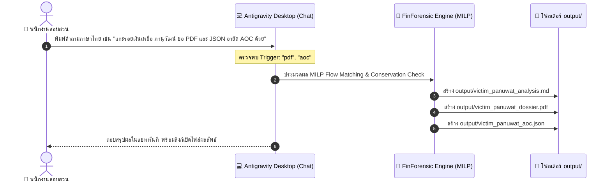

# 💬 คู่มือการสั่งงานด้วยภาษาธรรมชาติผ่าน Antigravity Desktop
> **สำหรับ:** พนักงานสอบสวน, เจ้าหน้าที่ตำรวจไซเบอร์ (บช.สอท.), นักวิเคราะห์ธุรกรรม และผู้ใช้งาน Antigravity Desktop  
> **หลักการทำงาน:** ไม่ต้องจำคำสั่ง Terminal / Python CLI เพียงพิมพ์คุยด้วยภาษาไทยหรือภาษาอังกฤษในช่องแชท Antigravity จะวิเคราะห์และดำเนินการให้โดยอัตโนมัติ

---

## 🧭 กฎเหล็กและคำสำคัญสั่งงาน (Magic Trigger Words)

ระบบ Antigravity ในโปรเจกต์นี้มีมาตรฐานการส่งมอบผลงานดังนี้:

| สิ่งที่ต้องการให้ทำ | คำสำคัญ (Trigger Words) ที่ควรมีในข้อความ | ผลลัพธ์ที่ Antigravity จะส่งมอบ |
| :--- | :--- | :--- |
| **วิเคราะห์ปกติ** *(ค่าเริ่มต้น)* | *"แกะรอย", "สืบเส้นทางเงิน", "วิเคราะห์", "ตรวจบัญชี"* | **ส่งออกคู่เสมอ (Dual Output):** 1. สรุปในแชท + ไฟล์ Markdown `output/*_analysis.md` 2. แดชบอร์ด Interactive HTML `output/*_dashboard.html` |
| **สร้างสำนวนคดีส่งศาล (PDF)** | **`pdf`**, **`dossier`**, **`สำนวนคดี`**, **`สร้างสำนวน`**, **`ส่งศาล`** | สร้างไฟล์ PDF ทางการฟอนต์ TH Sarabun New ใน `output/` |
| **ออกคำขออายัดฉุกเฉิน AOC 1441** | **`aoc`**, **`อายัดฉุกเฉิน`**, **`คำสั่งอายัด`**, **`ระงับธุรกรรม`**, **`freeze`** | สร้างไฟล์ JSON ส่งศูนย์ AOC 1441 ใน `output/` |

> 💡 **กฎเหล็ก Dual Output:** ทุกการวิเคราะห์หรือแกะรอยเส้นทางเงิน Antigravity จะสร้าง **Markdown Report คู่กับ Dashboard HTML เสมอ** โดยไม่ต้องสั่งเพิ่ม ส่วนไฟล์ **PDF** และ **JSON อายัด AOC** จะสร้างเมื่อมีคำสั่งระบุชัดเจนเท่านั้น

---

## 🗣️ ตัวอย่างประโยคสั่งงานจริงใน Antigravity Desktop

### 1. แกะรอยเงินผู้เสียหายเฉพาะราย (Targeted Victim Tracing)
คัดลอกประโยคด้านล่างไปพิมพ์ในแชทได้ทันที:

* **วิเคราะห์ทั่วไป (ได้ทั้งรายงาน Markdown + แดชบอร์ด HTML เป็นคู่เสมอ):**
  > *"ช่วยแกะรอยเงินของ จ่าสิบตรี ภานุวัฒน์ จากไฟล์ statement ใน input ให้หน่อย ดูว่าเงินถูกโอนต่อไปที่บัญชีใครบ้าง"*
  > *(ระบบจะส่งสรุปผลในแชท พร้อมสร้าง `output/victim_panuwat_analysis.md` และ `output/victim_panuwat_dashboard.html` ให้ทันที)*

* **สั่งออกสำนวนคดีส่งศาลเป็น PDF เพิ่มเติม:**
  > *"ช่วยวิเคราะห์เส้นทางเงินของเหยื่อชื่อ ภานุวัฒน์ จาก input/statement.csv และ**สร้างสำนวนคดีส่งศาลเป็นไฟล์ pdf** ฟอนต์สารบรรณให้ด้วย คดีเลขที่ 112/2569 ผู้สอบสวน พ.ต.ต. วิทวัส"*

* **สั่งออกคำขออายัดส่งศูนย์ AOC 1441 เพิ่มเติม:**
  > *"แกะรอยเงินของเหยื่อชื่อ ภานุวัฒน์ แล้วทำ**json คำสั่งอายัดฉุกเฉิน ส่ง aoc 1441** ให้ที"*

* **สั่งแบบครบวงจรชุดใหญ่ (วิเคราะห์ MD + HTML Dashboard + เพิ่ม PDF + เพิ่ม AOC JSON):**
  > *"ช่วยแกะรอยเงินของ จ่าสิบตรี ภานุวัฒน์ แบบครบวงจร ขอทั้งสรุปผล, **สร้างสำนวนคดี pdf**, และ**ไฟล์ json อายัดฉุกเฉิน aoc**"*

---

### 2. วิเคราะห์ภาพรวม Statement และตรวจจับพฤติกรรมผิดปกติ
* **ตรวจจับบัญชีม้าและการซอยยอด (Structuring):**
  > *"ช่วยวิเคราะห์ไฟล์ statement.csv ในโฟลเดอร์ input ให้หน่อย ตรวจดูว่าบัญชีนี้มีพฤติกรรมเป็นบัญชีม้าหรือไม่ มีการซอยยอด (smurfing) หรือระบายเงินออกเร็วแค่ไหน"*

* **ถามเจาะจงยอดเงินหรือบุคคลต้องสงสัย:**
  > *"ใน statement นี้ ยอดเงินเข้าก้อนใหญ่ที่สุดคือยอดของใคร เข้ามาเวลาไหน และหลังจากเงินเข้าแล้ว มีการโอนออกไปที่บัญชีไหนต่อบ้างภายในกี่นาที"*
  > *"มีบัญชีปลายทางไหนบ้างที่ได้รับเงินโอนซ้ำๆ หลายครั้ง สรุปยอดรวมของแต่ละคนให้ดูหน่อย"*

---

### 3. วิเคราะห์เครือข่ายบัญชีม้าหลายระดับ (Multi-Entity 5-Hop Syndicate)
สำหรับคดีขบวนการคอลเซ็นเตอร์หรือเว็บพนันที่มีเครือข่ายบัญชีม้าหลายแถว:

* **วิเคราะห์เครือข่ายในแชท:**
  > *"ช่วยวิเคราะห์เครือข่ายบัญชีม้า multi-entity 5-hop จากข้อมูลในโฟลเดอร์ techdocs ให้หน่อย สรุปว่ามีกี่แถว มีกลุ่มบุคคลหรือนิติบุคคลใดเป็นตัวการหลัก"*

* **สั่งสร้างแดชบอร์ดเครือข่ายและสำนวน PDF:**
  > *"วิเคราะห์เครือข่าย 5-hop syndicate แล้ว**สร้างแดชบอร์ด html** สำหรับเปิดดูผังความเชื่อมโยง และ**ออกสำนวนคดี pdf** ให้ด้วย"*

---

### 4. ซักถามข้อกฎหมายและการเฉลี่ยทรัพย์คืนผู้เสียหาย
* **คำนวณสิทธิขอคุ้มครองสิทธิผู้เสียหาย (ปปง. ม.49/1):**
  > *"จากข้อมูลเหยื่อ ภานุวัฒน์ ยอดความเสียหาย 470,000 บาท ถูกกระจายไปที่บัญชีใดบ้าง และตามสัดส่วนคณิตศาสตร์ MILP ควรทำเรื่องขอเฉลี่ยทรัพย์คืนจากบัญชีปลายทางแต่ละบัญชีเท่าใด"*

---

### 5. นำไฟล์ Statement ใหม่เข้ามาตรวจสอบ
เมื่อมีไฟล์ Statement ของคดีใหม่เข้ามา:

1. วางไฟล์ Statement (เช่น `case_123.csv`) ลงในโฟลเดอร์ `input/`
2. พิมพ์บอกในแชท Antigravity ได้เลย เช่น:
   > *"ฉันวางไฟล์ statement ใหม่ไว้ที่ input/case_123.csv ช่วยตรวจสอบโครงสร้างไฟล์ ตรวจสอบค่า hash sha-256 และวิเคราะห์หาบัญชีม้าแถวถัดไปให้หน่อย"*

---

## 📌 สรุป Workflow ใน Antigravity Desktop

---

## 💡 เคล็ดลับเพิ่มเติมสำหรับการใช้งานใน Antigravity Desktop
1. **ไม่ต้องกังวลเรื่องพิมพ์ผิด:** พิมพ์ชื่อ นามสกุล หรือเลขบัญชีแค่บางส่วน Antigravity จะค้นหาให้อัตโนมัติ (Fuzzy Matching)
2. **คลิกเปิดไฟล์ได้ทันที:** ในคำตอบของ Antigravity จะมีลิงก์ไปยังไฟล์ใน `output/` สามารถคลิกเปิดไฟล์ PDF หรือ HTML ในเครื่องได้ทันที
3. **ตรวจสอบความโปร่งใส:** ทุกการคำนวณจะอิงกับอัลกอริทึม MILP ทางคณิตศาสตร์ (`scipy.optimize.milp`) ที่ไม่มีการสุ่มหรือเดา จึงพร้อมนำไปใช้เบิกความหรือประกอบสำนวนคดีได้ทันที
