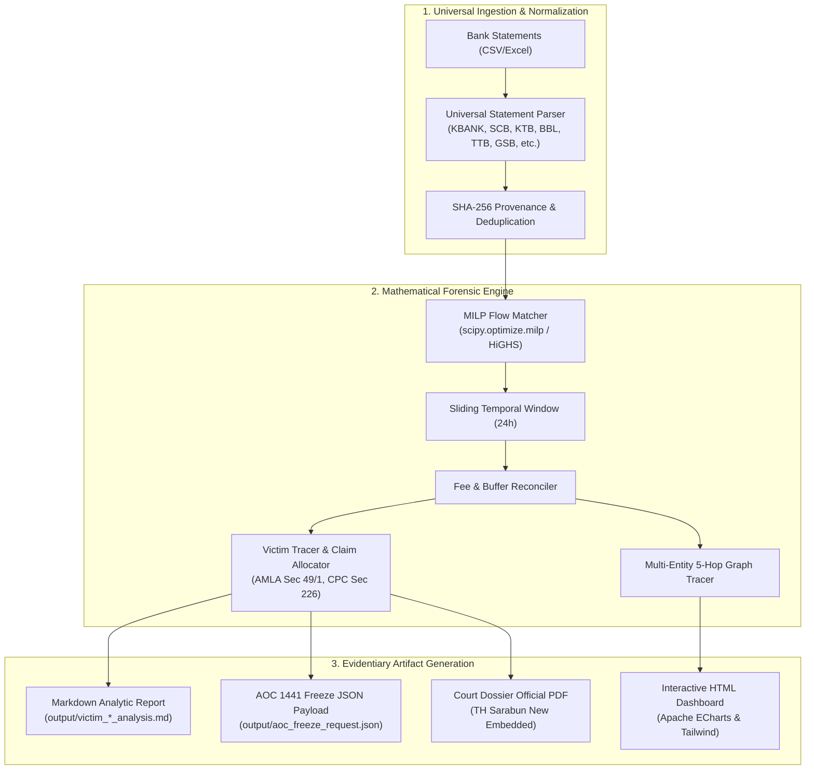

# 🏛️ FinForensic (ระบบวิเคราะห์เส้นทางการเงินเชิงนิติวิทยาศาสตร์และตรวจจับบัญชีม้า)
> **Enterprise Comprehensive Financial Forensics & Flow Matching Architecture**  
> *ระบบพิสูจน์ทราบเส้นทางการเงิน ขบวนการบัญชีม้า และคำนวณสิทธิเรียกร้องทรัพย์สินคืนสำหรับผู้เสียหาย ด้วยแบบจำลองทางคณิตศาสตร์ MILP รองรับมาตรฐานพยานหลักฐานชั้นศาล (ป.วิ.อาญา ม.226)*

---

## 📌 บทนำและภาพรวมระบบ (System Overview)

**FinForensic** ถูกออกแบบและพัฒนาขึ้นเพื่อแก้ปัญหาคอขวดในงานสืบสวนคดีอาชญากรรมทางเทคโนโลยี (แก๊งคอลเซ็นเตอร์, เว็บพนันออนไลน์, Hybrid Scam / Pig Butchering) ที่คนร้ายใช้เทคนิค **Structuring / Smurfing (การซอยยอดและกระจายเงินออกอย่างรวดเร็วผ่านบัญชีม้าหลายแถว)** พร้อมทั้งหลบเลี่ยงการตรวจสอบด้วย **Buffer Balance & Fee Residue** (ยอดโอนออกไม่เท่ากับยอดเงินเข้า 100% เนื่องจากมีค่าธรรมเนียมธนาคารและเงินติดบัญชีเดิม)

ระบบเปลี่ยนจากการตรวจสอบแบบ "สุ่มตรวจหรือคาดเดา" มาเป็น **การพิสูจน์ทราบด้วยแบบจำลองคณิตศาสตร์ความแม่นยำสูง (Mixed-Integer Linear Programming - MILP)** ผ่าน HiGHS Solver (`scipy.optimize.milp`) เพื่อสร้างพยานหลักฐานเชิงประจักษ์ที่สามารถรับฟังได้ในชั้นศาลตาม **ประมวลกฎหมายวิธีพิจารณาความอาญา มาตรา 226** และส่งข้อมูลอายัดฉุกเฉินไปยัง **ศูนย์ AOC 1441** ได้ทันที

---

## ⚡ คุณสมบัติหลัก (Key Capabilities)

| ขีดความสามารถ | รายละเอียดเชิงเทคนิค |
| :--- | :--- |
| **🧮 Mathematical Flow Matching** | ใช้ MILP (`scipy.optimize.milp`) จับคู่กระแสเงินเข้า-ออก (XD/XW) ภายใต้เงื่อนไข Fee-Buffer Tolerance ($\pm 5\%$) และ Time Horizon Window อย่างแม่นยำ ไม่ตกหล่น |
| **🎯 Targeted Victim Fund Tracing** | แกะรอยเงินของเหยื่อรายบุคคล (`trace-victim`) คำนวณสัดส่วนการกระจายเงินไปยังบัญชีปลายทาง และคำนวณ **Proportional Asset Restitution Claim** ตาม ปปง. ม.49/1 |
| **🌐 Multi-Entity 5-Hop Syndicate Graph** | วิเคราะห์เครือข่ายบัญชีม้าหลายแถว (1-5 Hops) ตรวจจับวงรอบการฟอกเงิน (Cycle Detection) และกลุ่มนิติบุคคลต้องสงสัย |
| **⚖️ Court-Admissible Dossier Export** | สร้างแฟ้มสำนวนคดีมาตรฐานทั้งรูปแบบ **Markdown** และ **PDF** ฝังฟอนต์ราชการไทย (**TH Sarabun New / TH Sarabun IT๙**) พร้อมตารางพยานหลักฐาน Exhibits A-D |
| **🚨 AOC 1441 Emergency Freezing Payload** | ส่งออก JSON Payload สำหรับระงับธุรกรรมและอายัดบัญชีฉุกเฉินตามมาตรฐานศูนย์ AOC 1441 / CFR |
| **📊 Interactive HTML Visual Dashboards** | สร้างแดชบอร์ด Single-Page แบบ Interactive (Apache ECharts) แสดงผัง Sankey Diagram, ไทม์ไลน์ธุรกรรม, โดนัทหมวดหมู่ และตารางค้นหาแบบ Real-time |
| **💬 Forensic Chat Copilot** | ระบบซักถามข้อมูลเส้นทางการเงินด้วยภาษาไทยและภาษาอังกฤษ ค้นหารายการผิดปกติและสรุปข้อมูลให้พนักงานสอบสวนทันที |
| **🔒 Cryptographic Chain of Custody** | บันทึกค่าแฮช SHA-256 และ Merkle Provenance Root ทุกขั้นตอน ป้องกันการแก้ไขพยานหลักฐานตาม พ.ร.บ. ธุรกรรมทางอิเล็กทรอนิกส์ |

---

## 🏗️ สถาปัตยกรรมระบบ (System Architecture)



---

## 📁 โครงสร้างโปรเจกต์ (Project Directory Structure)

```
FinForensic/
├── .agents/                 # Multi-Agent governance, roles & skill specifications
├── docs/                    # Architectural documents & testing policies
├── fonts/                   # Official Thai TrueType fonts (TH Sarabun New / IT๙)
├── harness/                 # Deterministic state machine & CLI orchestrator
│   ├── cli.py               # Unified CLI entry point
│   ├── schemas.py           # Pydantic state and task models
│   ├── state_machine.py     # Deterministic transition controller
│   └── verifier.py          # Ground-truth verification engine
├── input/                   # Evidence repository & sample bank statements
│   ├── statement.csv        # Primary bank statement sample (SHA-256 verified)
│   └── statement_mockup_*.csv
├── output/                  # Generated forensic reports, dossiers & dashboards
├── src/
│   ├── engine/              # MILP Flow Matching & Behavioral profiling
│   │   ├── flow_matcher.py  # Core Mixed-Integer Linear Programming solver
│   │   └── victim_tracer.py # Targeted victim fund dispersal and claim engine
│   ├── graph/               # Multi-entity multi-hop money trail tracer
│   ├── ingestion/           # Universal bank statement parsers & normalizers
│   ├── integrations/        # AOC 1441 CFR freezing payload builders
│   ├── models/              # Pydantic data schemas (Transactions, Dossiers)
│   ├── report/              # PDF Dossier generator with TH Sarabun embedding
│   └── ui/                  # Single-page ECharts interactive dashboard generators
├── techdocs/                # Deep technical blueprints & algorithmic proofs
├── AGENTS.md                # Multi-agent governance & anti-hallucination iron laws
├── MANUAL.md                # คู่มือการใช้งานแบบด่วนสำหรับพนักงานสอบสวน (Quickstart)
├── requirements.txt         # Core dependencies
└── README.md                # System documentation
```

---

## 🚀 การติดตั้งและเริ่มต้นใช้งาน (Installation & Quickstart)

### 1. ความต้องการของระบบ (Prerequisites)
- **Python:** 3.10 ขึ้นไป
- **OS:** Windows / macOS / Linux

### 2. ติดตั้ง Dependencies
```bash
pip install -r requirements.txt
```

### 3. คำสั่งทดสอบการทำงานด่วน (Quick Test)
```bash
# วิเคราะห์เส้นทางเงินของเหยื่อรายบุคคล (เช่น จ่าสิบตรี ภานุวัฒน์)
python -m harness.cli trace-victim --statement input/statement.csv --victim "ภานุวัฒน์"
```

---

## 📖 คู่มือการใช้งานระบบ (Documentation & Manuals)

* 💬 **[CHAT_MANUAL.md](./CHAT_MANUAL.md) (คู่มือการสั่งงานด้วยภาษาธรรมชาติผ่าน Antigravity Desktop — แนะนำสำหรับผู้ใช้งานหลัก)**:  
  ไม่ต้องจำคำสั่งคอมพิวเตอร์ สอนประโยคคำสั่งภาษาไทย/อังกฤษสำหรับพิมพ์สั่งงานในแชท Antigravity Desktop เพื่อแกะรอยเงินเหยื่อ, ออกหมายอายัด AOC 1441, สร้างสำนวนคดีส่งศาล PDF และแดชบอร์ด
* ⚡ **[MANUAL.md](./MANUAL.md) (คู่มือการใช้งานคำสั่งแบบด่วนผ่าน CLI)**:  
  สำหรับผู้ดูแลระบบหรือสายเทคนิคที่ต้องการรันสคริปต์อัตโนมัติผ่าน Terminal / Python CLI พร้อมตารางสรุปคำสั่งและแฟล็กทั้งหมด

---

## ⚖️ มาตรฐานความชอบด้วยกฎหมาย (Legal & Evidentiary Standards)

1. **ประมวลกฎหมายวิธีพิจารณาความอาญา มาตรา 226:**
   พยานหลักฐานต้องได้มาโดยชอบและมีความถูกต้องแท้จริง ระบบใช้อัลกอริทึม MILP ที่พิสูจน์ทราบได้ทางคณิตศาสตร์ (Deterministic) โดยไม่มีการเดาหรือสุ่มตรวจ
2. **พ.ร.บ. ว่าด้วยธุรกรรมทางอิเล็กทรอนิกส์ พ.ศ. 2544 (และฉบับแก้ไขเพิ่มเติม):**
   รองรับความสมบูรณ์ของเอกสารอิเล็กทรอนิกส์ด้วยการประทับ SHA-256 Hash และ Merkle Tree Root ตรวจสอบย้อนกลับได้ทุกรายการ
3. **พ.ร.บ. ป้องกันและปราบปรามการฟอกเงิน พ.ศ. 2542 (มาตรา 49/1):**
   ระบบคำนวณสิทธิเรียกร้องทรัพย์สินคืนของผู้เสียหายแต่ละรายตามสัดส่วนเงินจริง (Proportional Restitution Claim) เพื่อใช้แนบคำร้องขอคุ้มครองสิทธิผู้เสียหายต่อเลขาธิการ ปปง.

---

## 👥 ข้อกำหนดทีมพัฒนาและ Multi-Agent System
ระบบนี้ปฏิบัติตามมาตรฐานการควบคุมความถูกต้องอย่างเข้มงวด (Anti-Hallucination Protocols & Strict On-Demand Protocol) ภายใต้การควบคุมของ `AGENTS.md` ห้ามสร้างหรือสุ่มข้อมูลขึ้นเองโดยปราศจากพยานหลักฐานเชิงประจักษ์
